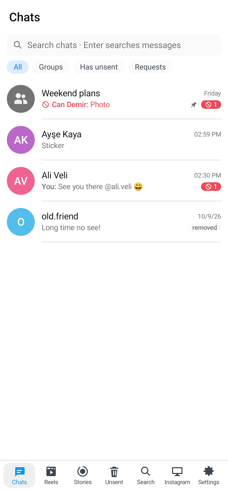
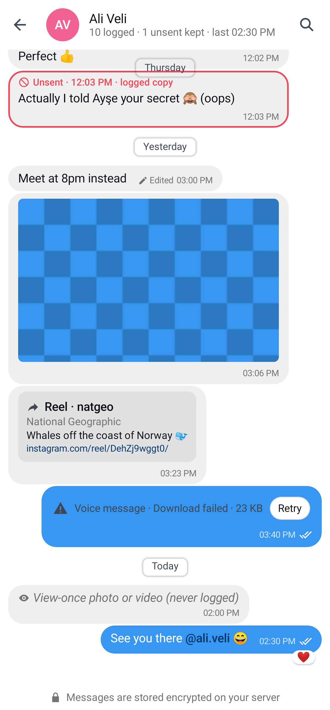
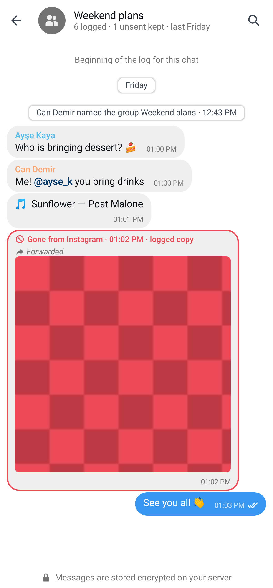
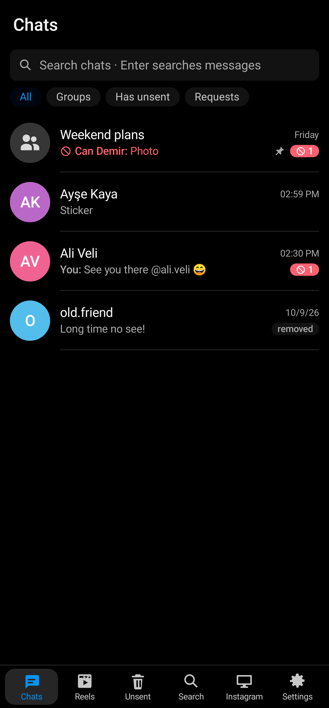

# insta_logger for Android

A native Android client (Kotlin, Jetpack Compose) for your self-hosted
[insta_logger](https://github.com/revocx35/insta_logger) server. It looks like insta_logger's web UI (Instagram's
colors, blue bubbles, light and dark), but it is a real app: native lists and media playback, a native view of the
server's Instagram browser, and the session kept in the Android Keystore.

**The phone never talks to Instagram.** Everything — your chats, sending, reels — goes through your server, so
Instagram only ever sees the server's browser and IP address.

| Chats | Chat | Group | Dark |
|---|---|---|---|
|  |  |  |  |

## Features

Through the same server API as the web UI (`shared/api.d.ts` of insta_logger):

- **Setup:** connect to your server, sign up with the setup token, save the recovery key, log in to Instagram
  (live browser view, status, *Complete*), or *log in with your own browser* (paste a copied request when Instagram
  keeps asking the server for a captcha), log in with 2FA, recover with the recovery key.
- **Chats:** chat list with search and filters (All / Groups / Has unsent / Requests), unsent counts, pinned,
  removed; the chat log with day separators, sender colors in groups, links and @usernames, replies (tap to jump),
  forwarded, edited (tap for the edit history), **unsent messages kept** with a red frame, reactions, seen tick,
  shared posts/reels/profiles (open on tap), music, disappearing and view-once markers, in-chat search.
- **Media:** photos (full screen, pinch to zoom), videos (streamed with Range requests), voice messages (inline
  player). Failed / too large / expired media can be retried.
- **Sending:** text, replies, reactions, edit and unsend your own messages, photos/videos and voice messages
  (Android 10+). Text typed with a file goes out right after it (Instagram has no captions).
- **Reels:** Instagram's reels feed, swipe up/down, tap to pause, double-tap or ♥ to like/unlike, comments with
  their first replies, comment and **reply to comments**, **Send** a reel into one or more chats, refresh the feed.
- **Stories:** the stories of the accounts you follow that the server logged (turn on in Settings → Logging, choose
  how many days to keep them, how often to check, everyone or chosen accounts): filter by account, grid, full-screen
  viewer, *Check now*. Never marked as seen.
- **Unsent** feed, global **Search**, **Instagram** (live view of the server's browser: tap = click, drag = scroll,
  pinch = zoom, keyboard, view-only switch, restart, log out), **Settings** (password, 2FA, recovery key, sessions,
  logging options, background session refresh, Instagram connection, security log, wipe).
- **Live updates** over the server's event stream while the app is open.
- Phones get the bottom menu, tablets / landscape (≥ 900 dp) get the side rail and two panes.

## Install

1. Download the APK from the [Releases](https://github.com/revocx35/insta_logger_android/releases) page, open it on
   the phone (allow "install unknown apps" for your browser or file manager once).
2. Open **insta_logger** and enter your server address — the same one you open in the browser.

Requires Android 8.0 (API 26) or newer.

### Server address, HTTPS and certificates

- **Public domain with a normal certificate** (e.g. behind Nginx Proxy Manager with Let's Encrypt): enter
  `https://ig.example.com`.
- **HTTP mode inside your home network** (`setup.sh --http-only`, e.g. `http://192.168.1.50`): works, with a note
  that the connection is not encrypted. Plain HTTP to a *public* address needs an explicit confirmation.
- **Caddy's internal certificate** (server opened by IP over HTTPS): the app shows the certificate's SHA-256
  fingerprint and asks whether to trust it, or import Caddy's root certificate once
  (`docker compose cp caddy:/data/caddy/pki/authorities/local/root.crt .`, then **Import a CA certificate…**).
  Trusted certificates only apply to your insta_logger server.

The app does not trust user-installed CAs from Android's settings, and hostname verification is never turned off.

## Security notes

- The session cookie is stored encrypted with a non-exportable AES-256-GCM key in the Android Keystore; the app's
  data is excluded from backups and device transfers. The server's session rules still apply (8 h idle / 7 days).
- Screenshots and the app-switcher preview are blocked by default (Settings → App → *Block screenshots*).
- Media is never cached on disk (memory only). *Open with…* writes a temporary private copy, deleted on next start.
- Message text is rendered as styled text, never as markup; only `http(s)` links are tappable; no link previews.
- Everything goes through the same authenticated API as the web UI (Origin + CSRF token on every change).
- Permissions: Internet, microphone (only when you record a voice message), local network (Android 17+, for a
  server on your home network), and the ones Android's WorkManager adds for the optional gallery auto-save (wake
  lock, network state, restart after boot). No location, contacts, camera or notifications.

## Build

Requirements: JDK 17+ (21 recommended) and the Android SDK (platform 37); point `local.properties` at the SDK.

```bash
./gradlew :app:assembleDebug        # app/build/outputs/apk/debug/app-debug.apk (installs as "…instalogger.debug")
./gradlew :app:assembleRelease      # signed if keystore.properties exists (see below)
```

Release signing: `keystore.properties` in the repo root (never committed) with `storeFile`, `storePassword`,
`keyAlias`, `keyPassword`. Keep that keystore: Android only installs updates signed with the same key. Releases are
built and signed by hand (the key never goes to CI): bump `versionCode`/`versionName` in `app/build.gradle.kts`,
`./gradlew :app:assembleRelease`, then `gh release create vX.Y.Z insta_logger-android-X.Y.Z.apk`.

## Tests

```bash
./gradlew :core:test                    # API client, events, Instagram text parser, formatter, VNC (RFB/ZRLE/DES)
./gradlew :app:testDebugUnitTest        # renders the main screens (Robolectric)
./gradlew :app:testDebugUnitTest -Proborazzi.test.record=true   # …and writes app/build/screenshots/
```

Against a real server (e.g. insta_logger's `fake-e2e.mts --keep` stack): login, CSRF, chats/messages/edits,
unsent copies, Range media, live events, a real VNC session, logout.
```bash
IGL_IT_BASE=https://localhost:29443 IGL_IT_USER=owner IGL_IT_PASSWORD='…' IGL_IT_CA=root.crt \
  ./gradlew :core:test --tests '*LiveServerTest*'
```

## Layout

```
core/   pure Kotlin/JVM: API DTOs (mirror of insta_logger's shared/api.d.ts), ApiClient, EventStream (SSE),
        IgText (port of web/src/lib/igText.tsx), Format, vnc/ (RFB client)
app/    Android UI: theme (web CSS tokens), components (bubbles, media, avatars…), screens (incl. Reels),
        VNC view, data/ (Keystore cookie jar, server trust, session/controller), media/ (player, viewer, save)
```

Based on the wa_logger Android client (same structure and security model), adapted to insta_logger.

## authentik (0.4.0)

If your reverse proxy puts insta_logger behind [authentik](https://goauthentik.io) forward auth, the app shows
**Sign in with authentik** on the connect screen: log in once in the browser; the app keeps an encrypted, revocable
refresh token. Setup: [docs/authentik.md](docs/authentik.md).

## Not included (yet)

- Push notifications (the server only offers a foreground event stream).
- Calls (insta_logger doesn't do Instagram calls).
